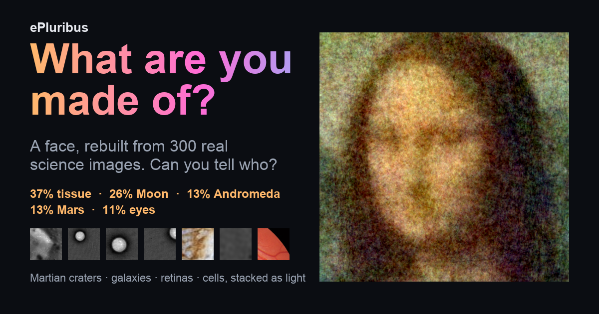

# ePluribus: what are you made of?

**[Play it free in your browser: davidackerman.github.io/ePluribus](https://davidackerman.github.io/ePluribus/)**

[](https://davidackerman.github.io/ePluribus/)

ePluribus is a free online toy that rebuilds any picture (a face, a pet, a landmark) from
**300 real images** - craters on Mars and the Moon, galaxies and nebulae, retinas and stained
cells, Earth from orbit, and paintings like Van Gogh's *Starry Night*. It's **not a mosaic**:
instead of tiling small photos side by side, every image covers the *whole* picture, layered
like a 300-image multiple exposure (or 300 slide projectors on one screen). Then share it and
see if your friends can guess what it is.

- **Make one:** pick a picture, then pick your universe - 18 packs in five tabs (space,
  planets, Earth & nature, life & medicine, art), all on by default. Watch it assemble and get
  a breakdown like *"37% tissue · 26% Moon · 13% Andromeda · 13% Mars · 11% eyes"*.
- **Share it:** a share link replays the build image by image; your friend taps *I got it!*
  the moment they recognise it, and can share their score back. There's also a built-in round
  to try (a famous face).
- **Explore:** fade all the pieces by how much each one adds, or tap any piece to see it full
  size, the picture without it, and - for map pieces - the exact spot on Mars or the Moon in
  [coresample](https://davidackerman.github.io/coresample/).
- **Save and post:** an animated GIF (Share GIF / Download GIF), the picture exactly as shown
  (at however many images you've scrubbed to) as a 512 px image, and link previews for chats
  and social media.
- **Private by design:** everything runs in your browser. Your photo is never uploaded; share
  links carry only which public pieces to stack.

## How it works

Every piece is a square crop of a real image, stretched to cover the whole frame. Pieces are
chosen greedily (non-negative matching pursuit) from thousands of random candidates: each step
adds the crop whose pattern of light and dark best fills in what's still missing, then
re-solves every piece's brightness (weights >= 0, like slide projectors on one screen). A
black level - the same grey subtracted from every pixel - removes the resulting glow, so the
colours come only from the images. (Switch off *Colour only from the images* to use one black
level per colour channel instead, which also matches your photo's overall colour, like a white
balance.) Each piece has a single brightness for the whole image - no masks, no per-pixel
tricks. "37% Moon" is each source's share of brightness x contrast.

The fit runs at 64 x 64 in parallel web workers (about 15 seconds for 300 images, including
downloads); the chosen crops are then re-cut at 256 px for display and 512 px for saving.

## Run it locally

```sh
python3 -m http.server 8765 --directory web
# open http://127.0.0.1:8765/
```

It must be served over HTTP (module scripts and workers don't load from `file://`).

## Image packs

`tools/make_packs.py` builds `web/packs/` (18 packs, about 7.6 MB) from three kinds of source:

- **scikit-image's science samples:** Hubble deep field, Moon, retina, cornea, tissue stains,
  fluorescent cells, head scans.
- **64 images from Wikimedia Commons**, listed in `tools/commons_picks.json`: famous
  paintings, science illustration (Haeckel, Audubon), patterns (William Morris, ornament),
  Earth from orbit, landscapes, oceans, planets, nebulae. They were reviewed by eye (safe for
  work; no duplicates, charts or photos of people), and the builder re-checks at build time
  that every one is still public domain or CC0.
- **Live maps** (below).

Each build uses up to 4 random images per pack, so no two builds are alike and downloads stay
small. Image and map ids in `packs.json` are part of the share-link format: never renumber
them, only append.

### Live maps

Some packs are huge public image pyramids read tile by tile from their hosts, as in
[coresample](https://github.com/davidackerman/coresample): the Moon (LRO WAC mosaic via NASA
Trek), Mars (CTX mosaic via Esri), Hubble's Andromeda and Webb's Carina nebula (ESA's Zoomify
archives). Each build fetches about 320 random tiles (random zoom, random place; roughly
10-20 MB), skips blank and no-data tiles, and cuts full-frame crops from them - so every build
uses different pieces, at every scale. Map specs are in `tools/make_packs.py` (`MAPS`); the
readers are in `web/maps.js`.

## Sharing and privacy

- **What a link holds:** a *recipe*, not the photo - for each piece, which public image (or
  map tile), crop position, size, rotation and brightness, plus the average colour (see
  `encodeRecipe` in `web/core.js`), and whether the black level was shared or per channel.
  It lives after the `#`, which browsers don't send to the
  server. Anyone with the link can rebuild the (blurry) picture; that's what sharing means.
  Pictures made with your own source images can't be shared as links.
- **Link length:** a full link (`#r=...`) is about 7,000 characters. **Short links**
  (`#s=...`, about 56 characters) need a small store: the recipe is encrypted in the browser
  (AES-GCM, a fresh key per picture) and the key stays in the `#fragment`, so the store can't
  read any picture. The live site has no store yet, so it shares full links.
  - Store contract: `POST {store}/s` with the bytes (<= 64 KB) -> `{"id": "..."}`;
    `GET {store}/s/{id}` -> the bytes; CORS open. Set its URL in `web/config.js`.
  - Development store: `python tests/short_link_store.py` (port 8799, in memory); on
    localhost the page finds it by itself.
- **Map hosts:** tiles are picked at random, independent of the photo, and the final render
  uses tiles already in memory, so the hosts never learn which pieces were chosen. A friend
  opening a link must fetch its exact tiles; their browser also fetches as many random decoy
  tiles, so a host's logs don't show only the picture's tiles.

## The GIF

360 x 440, about 1.2 MB: every image in a grid (strongest first, weak ones faint), then each
added in turn - flashing over the picture, with the latest few in a strip - ending on the
picture and its mix ("32% Moon · 27% Mars · ..."). Every frame carries the site's address.
Share GIF appears where the device can share files; Download GIF works everywhere.

## Layout

| Path | What |
|---|---|
| `web/index.html`, `app.js`, `style.css` | The page. |
| `web/core.js` | The maths: resampling, candidate pool, scoring, weight solver, rendering, recipes. No DOM. |
| `web/worker.js` | Scoring worker: holds a slice of the candidate pool. |
| `web/maps.js` | Live-map readers (web-map tiles, Zoomify): random tiles, decoys. |
| `web/share.js`, `web/config.js` | Short encrypted share links; deployment settings. |
| `web/gif.js` | Small animated-GIF encoder (median-cut palette + LZW). |
| `web/packs/` | Pack images, thumbnails and `packs.json` (built by `tools/make_packs.py`). |
| `web/samples/` | Sample pictures (Mona Lisa, astronaut, cat), the demo round's recipe and hero images. |
| `web/og.png` | Link-preview image. |
| `tools/make_packs.py` | Builds the packs: scikit-image samples, Wikimedia Commons picks, map thumbnails. |
| `tools/commons_picks.json` | The reviewed Wikimedia Commons images (append only). |
| `tools/make_demo.mjs` | Rebuilds the "Play a round" demo in the real app (needs Playwright). |
| `tests/core_test.mjs`, `tests/dump_raw.py` | Node test: fit quality vs the Python prototype, recipe round trip. |
| `tests/e2e.mjs` | Browser test (Playwright + system Chrome): build, share, replay, GIF, demo, phone layout. |
| `tests/short_link_store.py` | Development short-link store. |
| `.github/workflows/pages.yml` | Publishes `web/` to GitHub Pages. |
| `experiments/` | Python prototypes: full-frame fits, colour, animation and puzzle tests. |
| `superpose.py`, `collage.py`, `anim_*.py` | The original prototype scripts. |

## Tests

```sh
python3 -m venv .venv && .venv/bin/pip install -r requirements.txt
.venv/bin/python tests/dump_raw.py /tmp/ep_raw
node tests/core_test.mjs /tmp/ep_raw 3 10000 300

# browser test (needs Google Chrome and the site server; for short links,
# python tests/short_link_store.py too). Uses the network for the live maps.
npm install --no-save playwright-core@1.56.1
node tests/e2e.mjs http://127.0.0.1:8765/ /tmp/ep_shots
```

## Publishing

The site is live at https://davidackerman.github.io/ePluribus/. `.github/workflows/pages.yml`
pushes `web/` to the `gh-pages` branch whenever `web/` changes (as coresample does), and
GitHub Pages serves that branch.

## Credits and licences

- **scikit-image sample data:** each image's credit is in `web/packs/packs.json`, from
  scikit-image's documentation.
- **NASA** images (Moon map, astronaut photo, Earth from orbit, planets): public domain.
- **ESA/Hubble and ESA/Webb** (Andromeda, Carina nebula): CC BY 4.0, credited in the app.
- **Mars CTX mosaic:** free for all uses with the credit "NASA/JPL/MSSS/The Murray Lab".
- **Wikimedia Commons picks:** public domain or CC0; each credit (artist, title, source page)
  is in `packs.json` and shown under every picture made with it.
- **Samples:** Mona Lisa (public domain), the astronaut (NASA, public domain), the cat
  (scikit-image, CC0).
